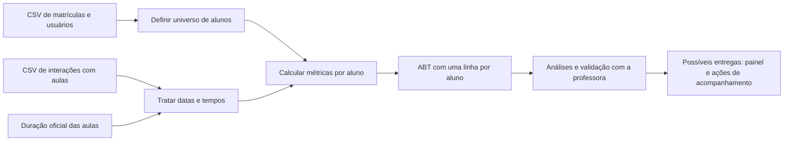

# Case ASN Rocks — Engajamento de alunos

Este projeto simula uma demanda real da plataforma de cursos ASN Rocks. A professora representa a demandante e os alunos trabalham em grupos. A pergunta central identificada nos materiais é: **quem está estudando, quem está se afastando e como orientar ações de acompanhamento?**

O desenvolvimento acontece no **Databricks**, com Spark/PySpark e SQL. A próxima entrega informada por Lucas é **7/11**, interpretada nesta documentação como **07/11/2026**. Lucas confirmou que o escopo é **ABT com métricas e um rascunho de dashboard**. Os critérios de avaliação e a ferramenta do dashboard ainda precisam ser definidos.

## Entenda o projeto em cinco minutos

As bases mostram matrículas, acesso às aulas e tempo assistido. O trabalho consiste em transformar esses registros em métricas e reunir o resultado em uma **ABT: uma tabela com uma linha por aluno**, pronta para análise e, futuramente, acompanhamento de engajamento.

Exemplo ilustrativo: um aluno pode ter estudado muito no passado e estar há semanas sem acessar. O volume acumulado mostra dedicação histórica; a recência mostra o afastamento atual. Precisamos das duas informações para decidir como acompanhá-lo.

Seu grupo já tem código para cinco dimensões — frequência, progresso, profundidade, revisão e recência —, um score ponderado e uma experiência de agrupamento de alunos. **É um protótipo com pontos pendentes de validação.** Há também um notebook mais refinado compartilhado por outro grupo, que calcula oito conjuntos de métricas. Ele é uma referência externa, conforme Lucas esclareceu em 20/10/2026, e sua implementação não equivale a trabalho já entregue pelo nosso grupo.

## O que ler

Para uma leitura guiada, use o [PDF de contexto e conversa](output/pdf/Guia_Projeto_ASN_Rocks.pdf), atualizado em 23/10/2026. Inclui o diagrama original e exemplos de perguntas para discutir o case.

| Leitura | Para que serve |
|---|---|
| [Andamento e próximos passos](docs/01-andamento.md) | Saber onde estamos e o que falta até a entrega |
| [Mapa de todos os materiais](docs/02-materiais.md) | Entender a função de cada um dos 17 arquivos recebidos e dos notebooks do GitHub |
| [Dados e construção da ABT](docs/03-dados-e-abt.md) | Entender as tabelas, seus relacionamentos e os limites da amostra |
| [Análise descritiva das tabelas](docs/06-analise-descritiva.md) | Ver campos, distribuições, qualidade e o papel de cada base |
| [Métricas e diferenças entre versões](docs/04-metricas.md) | Ler as fórmulas sem precisar decifrar os notebooks |
| [Revisão técnica e dúvidas](docs/05-validacoes-e-duvidas.md) | Separar problemas observados, decisões necessárias e sugestões |
| [Contexto permanente do projeto](PROJECT_CONTEXT.md) | Retomar o trabalho em conversas futuras |

## Fluxo do projeto

Os CSV locais abrangem 73 alunos; a regra do outro grupo seleciona 62 como pagantes. Os acessos detalhados vão de 18/11/2025 a 26/01/2026. **Data de revisão da documentação não é data dos dados.** Para reproduzir a análise histórica, usar uma data de corte explícita.

## Código existente e ambiente

- **[ABT do grupo traduzida para SQL](abt/sql/README.md):** implementação das cinco dimensões e do score, com instruções e checagens. Validação local concluída; execução no Databricks ainda pendente.

- [`abt/00_engajamento.ipynb`](abt/00_engajamento.ipynb): exploração, métricas, experimentos de progresso global/safra e score.
- [`abt/01_engajamento_clusters.ipynb`](abt/01_engajamento_clusters.ipynb): repete a construção das cinco dimensões e adiciona K-Means.
- Volume usado por esses notebooks: `/Volumes/case_asn/data/portal_asn/`.
- A referência do outro grupo usa `/Volumes/proj_ead/bases/bases/` e tabelas em `proj_ead.tabelas_metricas_aluno`.

Esses são ambientes/caminhos diferentes. Nenhum acesso ao workspace Databricks foi realizado nesta revisão. A leitura do código e das saídas salvas não comprova que ele executa hoje de ponta a ponta.

## Escopo desta organização

Revisão realizada em 20/10/2026 a partir da pasta local `Case ASN`, dos dois notebooks deste repositório e das respostas de Lucas. Foram publicados documentação e inventário; as bases e os documentos originais permanecem na pasta local. O repositório é público, por isso a documentação usa contagens agregadas.

O [vídeo de explicação do integrante](https://www.youtube.com/watch?v=n2U7tZijzXs) foi localizado, mas suas legendas retornaram vazias nas tentativas de extração. **Seu conteúdo falado ainda não foi incorporado.** A documentação não deve ser lida como resumo do vídeo.
