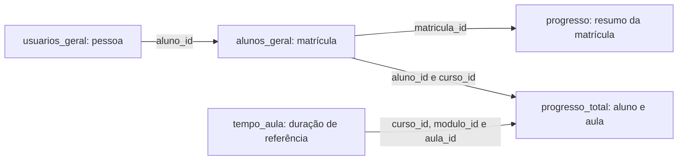

# Análise descritiva das bases

Análise calculada em 20/10/2026 sobre os quatro CSV originais e `tempo_aula.xlsx` da pasta Case ASN. **Não houve consulta ao Databricks**: os resultados descrevem os arquivos locais, e precisam ser reconciliados com a bronze se a carga tiver alterado linhas, tipos ou valores. Nulos incluem marcadores `NA` interpretados na leitura. Datas foram interpretadas em UTC, sem assumir a data civil de São Paulo.

## Como entender o conjunto

As bases representam três níveis diferentes: a pessoa, sua matrícula em um curso e sua interação com uma aula. Não se deve comparar as contagens desses níveis como se fossem a mesma coisa.

| Tabela | Uma linha representa | Linhas | Alunos distintos | Cursos distintos | Colunas |
|---|---|---:|---:|---:|---:|
| `usuarios_geral` | Um usuário/aluno cadastrado | 73 | 73 | — | 7 |
| `alunos_geral` | Uma matrícula de aluno em curso | 3.067 | 73 | 50 | 10 |
| `progresso` | O resumo do progresso de uma matrícula | 3.067 | 73 | 50 | 8 |
| `progresso_total` | O estado registrado de interação aluno–aula | 1.487 | 66 | 39 | 11 |
| `tempo_aula` | Uma aula e sua duração de referência | 206 | — | 39 | 6 |

Exemplo ilustrativo: um aluno tem uma linha em usuários, 50 matrículas, 50 resumos de progresso e 12 linhas de aulas se houver registros para 12 aulas diferentes. Somar matrículas não conta pessoas.

## 1. usuarios_geral — quem é o aluno

É a dimensão de cadastro da pessoa. A chave `aluno_id` é única, preenchida em todas as linhas e aparece nas demais bases.

| Campo | Função e interpretação |
|---|---|
| `aluno_id` | Identificador do aluno; chave para conectar as bases |
| `data_cadastro` | Cadastro original da conta na plataforma |
| `ultimo_acesso` | Último acesso geral informado para o usuário; não é necessariamente acesso a uma aula |
| `uf` | Localização informada, preenchida como nome do estado |
| `tipo` | Código de tipo de usuário; significado completo não documentado |
| `status` | Código de status do usuário; não confundir com status textual da matrícula |
| `username` | Nesta amostra é o rótulo `Aluno`, e não um nome de login individual |

**Resultados:** 73 alunos únicos, sem linhas integralmente duplicadas. Cadastro original entre 08/05/2024 e 28/11/2025. O último acesso geral preenchido vai de 31/05/2024 a 24/01/2026 e está ausente para dois alunos (2,7%).

A UF falta para 68 alunos (93,2%). Os cinco preenchimentos são três de São Paulo, um do Rio de Janeiro e um de Minas Gerais. Isso não sustenta uma análise regional representativa da turma. `tipo = 1`, `status = 1` e `username = Aluno` em todas as 73 linhas: esses campos não diferenciam perfis nesta amostra.

**Uso no case:** contar alunos únicos, preservar a data original do relacionamento e montar uma lista completa de pessoas, inclusive aquelas sem registros de aula. A base não contém notas, satisfação nem pagamentos.

## 2. alunos_geral — a quais cursos o aluno tem vínculo

Apesar do nome, esta não é uma tabela com uma linha por aluno: é uma tabela de matrículas.

| Campo | Função e interpretação |
|---|---|
| `matricula_id` | Identificador único da matrícula |
| `aluno_id`, `curso_id` | Pessoa e curso vinculados |
| `titulo_curso` | Nome do curso |
| `cadastro` | Data/hora de cadastro da matrícula neste recorte |
| `cadastro_data` | Data equivalente, sem horário |
| `inicio` | Data de início registrada; significado operacional ainda requer confirmação |
| `expira` | Data de expiração do vínculo/acesso conforme o dicionário |
| `suporte` | Data de término do suporte conforme o dicionário; há ressalva de desatualização nos materiais |
| `status` | Situação da matrícula no momento da extração |

**Resultados:** 3.067 matrículas únicas, 73 alunos e 50 cursos. Todas as matrículas estão como `Matrícula ativa`: a base não permite comparar ativos e inativos ou medir cancelamento observado.

| Matrículas por aluno | Quantidade de alunos |
|---|---:|
| 1 | 10 |
| 2 | 1 |
| 46 | 1 |
| 48 | 19 |
| 49 | 3 |
| 50 | 39 |

A mediana é 50 matrículas por aluno; a média é 42,0. Há dois grandes recortes de cadastro de matrícula: 922 linhas em 18/11/2025 e 2.145 em 28/11/2025. São 29 e 45 alunos presentes em cada data, respectivamente; **um aluno aparece nas duas datas**, portanto não somar 29 + 45 como pessoas diferentes.

`inicio` está ausente em 2.749 linhas (89,6%). Isso descreve matrículas sem início preenchido, não 89,6% dos alunos sem estudo. Existe um par aluno+curso com duas matrículas, embora `matricula_id` seja único. A duplicidade pode multiplicar registros em joins por aluno+curso.

**Uso no case:** definir o universo elegível, conferir vínculo e identificar os cursos disponíveis ao aluno. O grande número de matrículas por pessoa indica que a ausência de progresso em muitos cursos precisa ser interpretada à luz da grade disponibilizada; matrícula isolada não comprova intenção de estudar imediatamente cada curso.

## 3. progresso — resumo do avanço em cada matrícula

Esta base é um resumo por matrícula, útil para a visão aluno–curso.

| Campo | Função e interpretação |
|---|---|
| `matricula_id` | Chave única para relacionar ao cadastro de matrículas |
| `aluno_id`, `curso_id`, `curso_titulo` | Identificação da pessoa e do curso |
| `progresso` | Percentual de progresso fornecido pela plataforma |
| `aulas_acessadas` | Quantidade informada de aulas acessadas |
| `carga_horaria` | Duração associada ao consumo no resumo; não assumir que seja a duração total oficial do curso |
| `ultimo_acesso` | Última interação informada no nível do curso |

**Resultados:** 3.067 linhas, com correspondência completa por `matricula_id` em `alunos_geral`. Aluno e curso coincidem nos dois lados do relacionamento.

| Indicador | Resultado |
|---|---:|
| Matrículas com progresso zero | 2.768 (90,3%) |
| Matrículas com progresso positivo | 299 (9,7%) |
| Alunos com pelo menos um progresso positivo | 66 de 73 (90,4%) |
| Matrículas com progresso de 100% | 54 |
| Média do progresso nas 3.067 matrículas | 2,89% |
| Mediana do progresso nas 3.067 matrículas | 0% |
| Média somente nas 299 com progresso positivo | 29,60% |
| Mediana somente nas 299 com progresso positivo | 12,12% |

Essas médias são por matrícula, sem ponderar duração do curso. Não são o percentual global de estudo dos alunos.

Das 54 matrículas com 100%, 40 são em `Comece por aqui` e seis em `Happy Hour`. A conclusão do onboarding e de conteúdos especiais domina essa contagem; não é correto usá-la diretamente como conclusão de cursos técnicos. O campo da plataforma ainda depende de validação de negócio.

`ultimo_acesso` está ausente em 2.753 linhas (89,8%); os preenchidos vão de 18/11/2025 a 22/01/2026. Há 2.768 linhas com zero aulas acessadas. `carga_horaria` tem 2.872 zeros, e **109 matrículas possuem progresso positivo com tempo zero**. Logo, não é seguro assumir que progresso, quantidade de aulas e duração sejam medidas intercambiáveis.

**Uso no case:** visão agregada de avanço por curso, progresso informado pela plataforma e cobertura de cursos iniciados. A métrica precisa ser diferenciada de um progresso recalculado por tempo assistido.

## 4. progresso_total — o que foi registrado nas aulas

É a principal fonte comportamental disponível. Na amostra, a combinação aluno+aula é única. Isso sugere um estado consolidado por interação com a aula, não uma linha por play ou sessão.

| Campo | Função e interpretação |
|---|---|
| `aluno_id` | Aluno da interação |
| `curso_id`, `curso_titulo` | Curso da aula |
| `modulo_id` | Módulo ao qual a aula está associada |
| `aula_id`, `aula_titulo` | Identificação da aula |
| `log_id` | Nome sugere evento, mas na amostra é igual a `modulo_id`; não é uma chave única |
| `ultima_visualizacao` | Última visualização registrada daquela aula |
| `tempo_aula` | Tempo assistido/acumulado informado; funcionamento do contador a confirmar |
| `data_conclusao` | Campo de conclusão; alguns materiais o interpretam como primeiro play, ainda sem comprovação técnica |
| `aula_concluido` | Flag 0/1 de conclusão da plataforma; não garante consumo integral |

**Cobertura:** 1.487 registros, 66 alunos, 39 cursos, 64 módulos e 206 aulas distintas. Há 183 títulos de aula: títulos se repetem, por isso não devem ser usados como chave. Sete dos 73 alunos não possuem linha nesta base. Dos 66 com registros, 61 possuem algum tempo positivo.

As últimas visualizações vão de 18/11/2025 a 26/01/2026. Em 1.304 linhas a última visualização é posterior ao campo de conclusão; em 168 são iguais e em 15 a conclusão está ausente. Não há casos de última visualização anterior à conclusão entre os pares válidos.

| Tempo assistido por registro com duração válida | Resultado |
|---|---:|
| Registros com tempo válido | 1.459 |
| Ausentes | 28 (1,9% dos registros) |
| Tempo zero | 235 |
| Mediana | 9min23s |
| Média | 35min25s |
| Percentil 75 | 30min17s |
| Máximo | 22h23min46s |
| Soma de tempos registrados | 861,18 horas |

A diferença entre média e mediana e o máximo elevado mostram uma distribuição assimétrica. As 861,18 horas são tempo registrado, sem ajuste para repetição ou validação de atenção. Não equivalem a horas de aprendizagem comprovada.

Entre os 66 alunos com registros, a mediana da soma de tempo por aluno é 6,65 horas e a média 13,05 horas. A mediana de aulas distintas por aluno é 17,5; o máximo é 105.

**Conclusão exige cuidado:** 1.472 linhas (99,0%) estão com `aula_concluido = 1`. Dentro delas, 235 têm tempo zero e 28 não têm tempo preenchido. O sinal de check não é evidência suficiente para afirmar que a pessoa assistiu à aula.

| Curso | Alunos com registro de aula | Registros aluno–aula |
|---|---:|---:|
| Comece por aqui | 57 | 456 |
| Construindo sua Fluência em Dados | 40 | 304 |
| Palco Florence | 27 | 53 |
| IDA | 25 | 480 |
| Aulas ao Vivo Universo dos Dados | 23 | 36 |

As contagens incluem qualquer registro, sem filtro de minutos mínimos, elegibilidade de pagantes ou exclusão de conteúdos. Não são ranking de satisfação, horas ou aprendizagem.

**Uso no case:** recência, dias observáveis de atividade, consumo de tempo, cobertura de aulas e aproximações de revisão. Como há somente datas extremas por aula, não é possível reconstruir todo o histórico de sessões nem distribuir com precisão o tempo acumulado pelos meses.

## 5. tempo_aula — qual duração usar como referência

A planilha tem 206 linhas e seis campos: `curso_id`, `curso_titulo`, `modulo_id`, `aula_id`, `aula_titulo` e `Tempo`. A chave curso+módulo+aula é única. Os campos não têm nulos, e as 206 durações puderam ser interpretadas.

| Indicador de duração oficial registrada | Resultado |
|---|---:|
| Cursos presentes | 39 |
| Mediana por aula | 34min00,5s |
| Média por aula | 1h18min49s |
| Máximo por aula | 5 horas |
| Durações zero | 1, em Happy Hour |

**As 1.487 linhas de `progresso_total` encontram correspondência nessa dimensão manual** pela chave curso+módulo+aula. Isso é cobertura completa das interações observadas neste recorte, mas não comprova que a dimensão inclua todas as aulas disponíveis dos cursos. A duração completa de uma grade exige o arquivo de catálogo completo, como o `asn_aulas_duracao.csv` citado nos notebooks.

Em 718 registros (48,3% das 1.487 interações), o tempo assistido supera a duração registrada da aula. Isso pode refletir repetição, funcionamento do contador ou inconsistência: tratar como sinal a investigar, e não como revisão confirmada. A linha de duração zero também exige regra específica.

**Uso no case:** limitar crédito de progresso à duração da aula, calcular proporção assistida e investigar repetição. Não somar só essas 206 aulas para estabelecer, sem validação, a carga completa dos cursos.

## Relacionamentos verificados



- Nenhum registro de aula aponta para aluno ausente de `usuarios_geral`.
- Nenhuma matrícula está ausente de `progresso`, e nenhum progresso está sem matrícula correspondente.
- Não há divergência de aluno ou curso nos pares ligados por `matricula_id`.
- Todos os registros de aula possuem um par aluno+curso existente nas matrículas.
- Nenhuma das cinco bases tem linhas integralmente duplicadas. Isso não elimina duplicidade de vínculo: há um par aluno+curso com duas matrículas, capaz de multiplicar um join.

Não fazer join direto de todas as tabelas e depois somar seus valores: o resumo de uma matrícula pode ser repetido uma vez por aula. Agregar os fatos no nível desejado antes de combiná-los.

## O que isso significa para a ABT e o dashboard

O denominador deve ser explícito: alunos, matrículas e aulas respondem a perguntas diferentes. A leitura de 90,3% das matrículas com progresso zero precisa conviver com 90,4% dos alunos com algum progresso. Uma taxa isolada produziria uma conclusão enganosa sobre inatividade.

Montar a ABT a partir de uma lista de alunos preserva os sete sem interação detalhada. Separar cadastro original, matrícula e primeiro acesso evita misturar três definições de tempo de relacionamento. Definir quais cursos entram evita que onboarding e agenda dominem indicadores de conclusão.

No dashboard, exibir data de corte e distinguir cadastro, elegibilidade, presença de registro e consumo positivo. Os dados permitem descrever uso observado; não permitem afirmar, isoladamente, satisfação, aprendizagem ou abandono confirmado.

## Reprodução

O script [`scripts/analisar_bases.py`](../scripts/analisar_bases.py) calcula o perfil sem editar os arquivos. Requer `pandas` e `openpyxl` para leitura. Exemplo:

```text
python scripts/analisar_bases.py --pasta "CAMINHO_DOS_MATERIAIS" --saida perfil.json
```

O caminho completo das tabelas da bronze ainda não foi confirmado entre `case_asn.bronze` e `bronze.case_asn`. Essa diferença não interfere na análise local, mas precisa ser resolvida antes de executar consultas no workspace.
